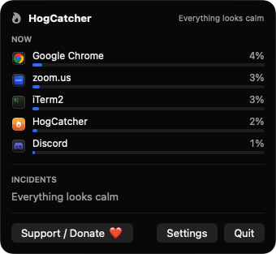
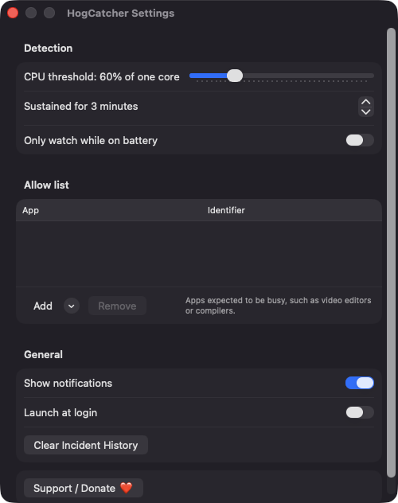
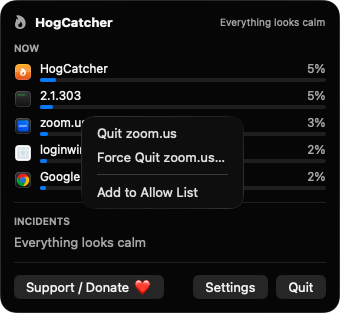

# HogCatcher

**🌐 Website:** [turhe123.github.io/hog-catcher](https://turhe123.github.io/hog-catcher/)

**Warns you when an app quietly burns CPU in the background, so you can quit it and save battery.**

> 🆓 A free, open-source **MenuBarMonitor alternative** for macOS 14+. Native Swift, no accounts, no subscriptions, MIT licensed.


## Why

HogCatcher is a free, open-source, 100% native, backend-free alternative to paid utilities in the *System Monitoring* category. It was inspired by MenuBarMonitor ($15 one-time), and it focuses on one sharp job: catching apps that stay busy in the background and offering a one-click way to deal with them. Everything runs on your Mac. There is no server, no account and no analytics.

## Features

- **Menu bar flame icon.** Gray when everything is calm, orange while a hog is active.
- **Background hog detection.** CPU use is sampled every 5 seconds. An app is flagged when it stays above a CPU threshold (default 60% of one core) for a set time (default 3 minutes) while it is not the frontmost app.
- **Helper processes counted as one app.** Helpers and renderers are grouped under their owning app by bundle and parent process, so a browser and its helpers show up as a single row.
- **Live "Now" list.** The popover shows the top five CPU consumers with live bars. Right-click a row to Quit, Force Quit (after a confirmation) or add it to the allow list.
- **Incidents.** A history of past hog events with average CPU, duration and timestamp. The popover shows the last 20. History is capped at 100 entries and saved as JSON in Application Support.
- **Actionable notifications.** Each warning names the app, how hard and how long it ran, with **Quit App**, **Ignore for Today** and **Never Warn** buttons. Repeat warnings for the same app are snoozed for 30 minutes.
- **Allow list.** Add apps that are expected to be busy, such as video editors or compilers. Choose them from running apps or browse for an app.
- **Settings.**
  - CPU threshold slider, 20–200%.
  - Duration stepper, 1–30 minutes.
  - "Only watch while on battery" switch (the popover shows "Paused on AC power" while plugged in).
  - Notifications toggle.
  - Launch at login.
  - Clear incident history.
- **Safety rails.** Processes younger than 10 seconds are ignored. The first sample after wake is discarded. Root-owned system processes are listed as informational only, with no quit options. Finder, WindowServer, loginwindow, kernel_task and HogCatcher itself are never offered for quitting.
- **Keyboard shortcuts.** ⌘, opens Settings and ⌘Q quits.

## Screenshots

<p align="center"></p>

<p align="center"><em>The menu bar popover lists the top five CPU users live, along with recent hog incidents.</em></p>

<p align="center"></p>

<p align="center"><em>In Settings you can tune the CPU threshold and duration, run only on battery, manage the allow list and turn notifications on or off.</em></p>

<p align="center"></p>

<p align="center"><em>Right-click any app in the list to quit it, force quit it, or add it to the allow list.</em></p>

## Install

1. Download `HogCatcher-macOS.zip` from the [latest release](https://github.com/turhe123/hog-catcher/releases/latest).
2. Unzip it and move `HogCatcher.app` to `/Applications`.
3. The app is open source and not notarized, so macOS will quarantine it. Clear the quarantine flag:

   ```bash
   xattr -cr /Applications/HogCatcher.app
   ```

4. The first time, right-click the app and choose **Open**.

Requires macOS 14.0 or later.

## Build from source

You need Xcode and [XcodeGen](https://github.com/yonaskolb/XcodeGen).

```bash
brew install xcodegen
xcodegen generate
xcodebuild -project HogCatcher.xcodeproj -scheme HogCatcher -configuration Release -derivedDataPath ./build build
```

The app is written to `build/Build/Products/Release/HogCatcher.app`.

## Permissions

HogCatcher asks for very little:

- **Notifications.** Requested at launch (alerts and sound) so it can warn you about a hog. If you decline, the popover and incident list still work. Settings shows a shortcut to System Settings.
- **Launch at login.** Optional. It is registered through `SMAppService` only when you turn it on.
- **Accessibility, Screen Recording, Microphone, Camera, Location, Full Disk Access.** Not requested. The code doesn't use them. It reads CPU time for processes your user can already see, using `proc_pid_rusage`, and reads the power source status to detect battery.

Settings are stored in UserDefaults. Incident history is stored in `~/Library/Application Support/HogCatcher/incidents.json`.

## Support ❤️

HogCatcher is free and always will be. If it saved your battery, you can [Support Or (Leo) Davidai ❤️](https://ko-fi.com/leodavidai) on Ko-fi. The app also has a **Support / Donate ❤️** button in the popover and in Settings.

## More free Mac apps

HogCatcher is one of [60 free, open-source Mac utilities](https://github.com/turhe123/mac-apps) built the same way: native Swift, no accounts, no telemetry. Browse the full gallery at [turhe123.github.io/mac-apps](https://turhe123.github.io/mac-apps/).

## License

MIT © Or Davidai Bachar
